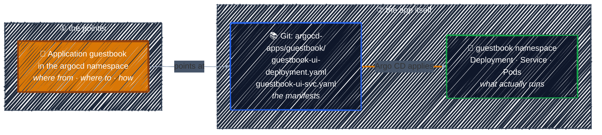

# Applications vs. Kubernetes Manifests

> An Application doesn't *contain* your app. It *points at* the manifests that do.

---

The most common beginner mix-up: "I created the Application, so where's my Deployment inside it?" It isn't inside. There are **two separate layers**: the **pointer** (the Application), and the **app itself** (its manifests in Git, plus the resources Argo CD creates from them).



| | Application | Kubernetes manifests |
|---|---|---|
| Kind | `Application` (an Argo CD CRD) | `Deployment`, `Service`, `ConfigMap`, … |
| Answers | **Where** is the code? **Where** should it run? **How** should it sync? | **Which** image to run? **Which** ports to open? **How many** replicas? |
| Stored in Git at | this tutorial: `manifests/argocd-core-concepts/application.yaml` *(real projects: the config repo's `apps/` folder, see [App of Apps](application-crd.md#three-ways-to-create-one))* | the config repo `argocd-apps`: `guestbook/` |
| In the cluster | the Application object, in the `argocd` namespace | the resources they create, in your app's namespace (`guestbook`) |
| Read by | Argo CD's **application-controller** | **Kubernetes controllers** (e.g. the Deployment controller), once Argo CD has applied them |
| You change it when… | the app moves to another repo, path, cluster or namespace | the app itself changes: new image, more replicas, … |

In short: **the Application says *where*, the manifests say *what*.**

### Consequences worth knowing

- **Day-to-day changes go to the manifests, not the Application.** To deploy a new image you edit `guestbook-ui-deployment.yaml` and push. The Application stays untouched.
- **You never `kubectl apply` the manifests yourself.** Argo CD does that. If you do it by hand, it's the drift you saw in [the push model](../gitops-intro/push-model.md).
- **The manifests are ordinary Kubernetes YAML.** In this guide they're plain files that would work with `kubectl apply -f`. If a repo uses Helm or Kustomize instead, the repo-server renders it to the same plain YAML first. Either way, Argo CD adds no special syntax.
- **One set of manifests can have many pointers.** Because the two layers are separate, you can create `guestbook-staging` and `guestbook-prod` Applications that share the same base manifests, each pointing at its own Kustomize overlay (say, more replicas in prod), and deploy them to different namespaces or clusters. When the list of environments grows, an **ApplicationSet** generates those Applications from one template.
- **Deleting the pointer doesn't always delete the app.** `argocd app delete` (or Delete in the UI) removes both layers; that's how you'll clean up after the [sync lab](sync-and-health.md#lab-the-sync-process). A plain `kubectl delete application` removes only the pointer and leaves the app running (unless the Application has the `resources-finalizer.argocd.argoproj.io` finalizer).

### Lab: Deploy Your First Application

> Fork the config repo, point an Application at its `guestbook/` folder, and let Argo CD deploy it.

<details>
<summary><b>Show the lab steps</b></summary>

**Goal:** deploy **guestbook**, Argo CD's classic example app (a `guestbook-ui` Deployment and Service), without ever running `kubectl apply` on the app itself.

**Before you start:** you're logged in to Argo CD (`argocd app list` works), see [Accessing Argo CD](../argocd-getting-started/accessing-argocd.md). Run the commands on the VM.

#### 1. Get the two repos

This lab uses the [two-repo layout](../gitops-intro/gitops-workflow.md) from the GitOps chapter:

| Repo | Holds | You need |
|------|-------|----------|
| **`argocd-apps`** (config repo) | the guestbook manifests in `guestbook/` | **your own fork**: in the [sync lab](sync-and-health.md#lab-the-sync-process) you'll push changes to it |
| **this tutorial** | the Application in `manifests/argocd-core-concepts/application.yaml` | a clone |

1. Fork **`https://github.com/r97221004/argocd-apps`** on GitHub. Keep the fork **public** so Argo CD can read it without credentials.
2. Clone both onto the VM:

   ```bash
   git clone https://github.com/<YOUR_GITHUB_USER>/argocd-apps.git
   git clone https://github.com/r97221004/argoCD-tutorial.git
   ```

The app Argo CD will deploy is in your fork:

```bash
ls argocd-apps/guestbook/   # guestbook-ui-deployment.yaml  guestbook-ui-svc.yaml
```

#### 2. Point the Application at your fork

In the tutorial clone, edit [`manifests/argocd-core-concepts/application.yaml`](../../manifests/argocd-core-concepts/application.yaml) and replace `<YOUR_GITHUB_USER>` with your GitHub account:

```yaml
    repoURL: https://github.com/<YOUR_GITHUB_USER>/argocd-apps.git
```

#### 3. Create the Application

```bash
cd argoCD-tutorial
kubectl apply -f manifests/argocd-core-concepts/application.yaml
```

This is the only `kubectl apply` in the lab, and it creates the *pointer*, not the app. Check what Argo CD thinks:

```bash
argocd app get guestbook
```

```
Sync Status:        OutOfSync from HEAD (…)
Health Status:      Missing
```

- **OutOfSync**: Git has a Deployment and a Service, but the cluster doesn't.
- **Missing**: the resources don't exist yet.

Nothing was deployed, because the Application has no automated sync. Argo CD only *reports* the difference. Confirm it:

```bash
kubectl get ns guestbook   # NotFound
```

#### 4. Sync

Tell Argo CD to make the cluster match Git:

```bash
argocd app sync guestbook
```

Or in the UI: open **guestbook** → **SYNC** → **SYNCHRONIZE**.

Then wait until it's healthy:

```bash
argocd app wait guestbook --health
argocd app get guestbook
```

```
Sync Status:        Synced to HEAD (…)
Health Status:      Healthy
```

#### 5. Look at both layers

```bash
kubectl get applications -n argocd          # the pointer
kubectl get deploy,svc,pods -n guestbook    # what it deployed
```

The namespace, the `guestbook-ui` Deployment and Service, and its Pod all exist. You never applied them: Argo CD did, from your fork. In the UI, the app's tree view shows the same thing: **Application → Deployment → ReplicaSet → Pod**, plus the Service.

Want to see the guestbook page itself? Port-forward the Service and open `http://localhost:8081` (tunnel it with `ssh -L` if the VM is remote, as in [Accessing Argo CD](../argocd-getting-started/accessing-argocd.md)):

```bash
kubectl -n guestbook port-forward svc/guestbook-ui 8081:80
```

#### Checkpoint

| You did | Which means |
|---------|-------------|
| `kubectl apply` the **Application** | you created layer ①, the pointer: it told Argo CD *where* to look |
| `argocd app sync` | Argo CD created layer ②'s resources in the cluster from Git, **once** |
| Never applied the guestbook YAML | Git is now the only source of the app |

Leave the app running: the [sync lab](sync-and-health.md#lab-the-sync-process) changes it.

</details>

---

[← The Application CRD](application-crd.md) · [↑ Contents](../../README.md) · [Sync and Health Checks →](sync-and-health.md)
