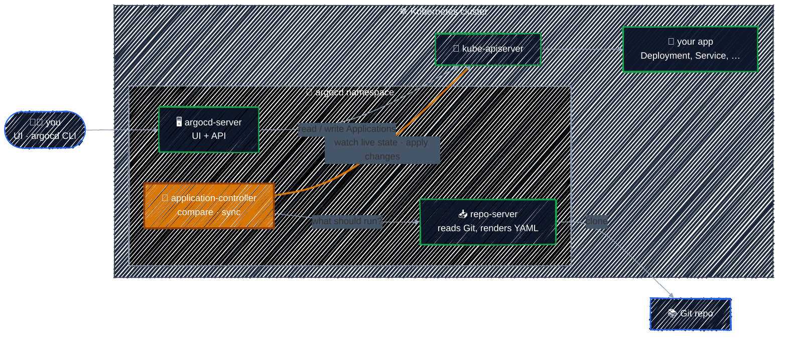

# The Argo CD Architecture

> Three main components, each with one job: one serves you, one reads Git, one changes the cluster.

---

In [Installing Argo CD](../argocd-getting-started/installing-argocd.md) you saw about seven `argocd-` Pods. Only three of them do the core GitOps work. The others are helpers.

### The three core components

| Component | Its one job | Think of it as |
|-----------|-------------|----------------|
| **argocd-server** | Serves the web UI and the API that the `argocd` CLI talks to. | the front desk |
| **argocd-repo-server** | Clones Git repos and turns them into plain Kubernetes YAML (rendering Helm or Kustomize if needed). | the reader |
| **argocd-application-controller** | Compares that YAML with what's running, reports the difference, and applies changes when it syncs. | the worker |

The **application-controller** is where GitOps actually happens: it runs the reconcile loop from [The GitOps Principles](../gitops-intro/gitops-principles.md). The other two only *show* (server) and *read* (repo-server).

### The helpers

| Component | What it does |
|-----------|--------------|
| **argocd-redis** | a cache, so Git and the cluster aren't asked the same thing over and over |
| **argocd-dex-server** | SSO login (GitHub, Google, …). Unused while we log in as `admin`. |
| **argocd-applicationset-controller** | generates many Applications from one template |
| **argocd-notifications-controller** | sends Slack/email messages on sync events |

If a helper is down, Argo CD mostly keeps working. If one of the three core components is down, something visible breaks:

| If this is down… | You'll notice |
|------------------|---------------|
| argocd-server | the UI and CLI stop responding, **but syncing continues** |
| repo-server | apps show `Unknown` / comparison errors: Argo CD can't read Git |
| application-controller | nothing syncs and drift isn't detected, even though the UI loads fine |

> When something looks wrong, ask *which job* failed: showing, reading or syncing. That tells you which Pod's logs to read, e.g. `kubectl -n argocd logs deploy/argocd-repo-server`.

### Where Argo CD keeps its state

Argo CD has no database. Everything it needs is stored as ordinary Kubernetes objects in the `argocd` namespace:

- **Applications** (a CRD): what to deploy, from where, to where. Covered on the next page.
- **ConfigMaps and Secrets**: settings, repo credentials, and the admin password hash you changed in [Accessing Argo CD](../argocd-getting-started/accessing-argocd.md).

That's why it can be installed with a Helm chart, and why backing up Argo CD mostly means backing up the `argocd` namespace.

---

[← Accessing Argo CD](../argocd-getting-started/accessing-argocd.md) · [↑ Contents](../../README.md) · [The Application CRD →](application-crd.md)
