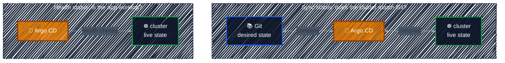

# Sync and Health Checks

> Every Application has two separate statuses: does the cluster *match Git*, and is the app *working*?

---

In the [first lab](applications-vs-manifests.md#lab-deploy-your-first-application) you saw two lines: `Sync Status` and `Health Status`. They answer different questions, and they change independently.

They also look at different things. Sync status compares **Git with the cluster**. Health status looks **only at the cluster**:



Health judges what's *running*, not what Git says, which is why an app can match Git perfectly and still be broken.

### Sync status: does the cluster match Git?

| Status | Meaning |
|--------|---------|
| **Synced** | The live resources match the manifests in Git. |
| **OutOfSync** | Something differs: a new commit in Git, or a change made directly in the cluster ([configuration drift](../gitops-intro/push-model.md#configuration-drift)). |
| **Unknown** | Argo CD couldn't compare, usually because it can't read the repo or the YAML is invalid. |

### Health status: is the app working?

| Status | Meaning | Example |
|--------|---------|---------|
| **Healthy** | Running as expected. | Deployment has all replicas ready |
| **Progressing** | Not ready yet, but on its way. | Pods are starting during a rollout |
| **Degraded** | Failed. | a rollout that never became ready before its deadline (10 minutes by default) |
| **Missing** | In Git, but not in the cluster. | before the first sync |
| **Suspended** | Paused on purpose. | a suspended CronJob |

Argo CD has built-in health checks for common kinds. For example, a Deployment is Healthy when its updated replicas are all available.

The Application's own health is the **worst** of its resources: if one Deployment is Degraded, the whole app shows Degraded, even when everything else is Healthy.

### Why two statuses?

Because each can be fine while the other isn't:

| Sync | Health | What's going on |
|------|--------|-----------------|
| Synced | Healthy | ✅ Git is deployed and works. |
| Synced | Progressing → Degraded | Git was applied correctly, but what's *in* Git is broken, e.g. an image tag that doesn't exist: Progressing at first, Degraded once the rollout times out. **Fix Git.** |
| OutOfSync | Healthy | The app works, but doesn't match Git: a new commit isn't synced yet, or someone changed the cluster by hand. |
| OutOfSync | Missing | Nothing deployed yet, like the first lab before you pressed Sync. |

> "Synced" doesn't mean "working", and "Healthy" doesn't mean "matches Git". Check both.

> **A third thing to check: the last sync *operation*.** Sync status is a comparison. Each time Argo CD actually *runs* a sync, it also records how that run went: **Running**, **Succeeded** or **Failed** (for example, the API server rejected a manifest). `argocd app get` shows it under **Operation**, on the `Phase:` line; the UI shows it as **Last Sync**. So an app can be OutOfSync *and* have its last sync Failed: the run didn't fix the difference.

### Refresh vs. sync

Two buttons in the UI that are easy to mix up:

| | Refresh | Sync |
|---|---|---|
| What it does | Re-reads Git and **re-compares**. Changes nothing. | **Applies** Git to the cluster. |
| When it happens on its own | every 3 minutes by default | only with automated sync |
| CLI | `argocd app get <app> --refresh` | `argocd app sync <app>` |

Changes made directly in the cluster show up right away, because Argo CD watches the cluster continuously. New commits in Git are only noticed on the next refresh, so after a `git push`, press **Refresh** if you don't want to wait.

### Sync policy: who presses Sync?

| Setting | Effect |
|---------|--------|
| *(none)* | **Manual.** Argo CD reports OutOfSync and waits for you. |
| `automated: {}` | Syncs automatically when **Git** changes. |
| `automated.selfHeal: true` | Also reverts changes made directly in the **cluster**. |
| `automated.prune: true` | Also deletes resources that were **removed from Git**. |

By default, automated sync **doesn't** self-heal and **doesn't** prune. Both are opt-in, so Argo CD never deletes or overwrites something unless you asked for it. The lab below stays manual; automated sync gets its own chapter later.

### Lab: The Sync Process

> Change the app through Git, break it through `kubectl`, and see Argo CD report both.

<details>
<summary><b>Show the lab steps</b></summary>

**Goal:** see a Git change go out with a manual sync, then catch drift made with `kubectl` and undo it.

**Before you start:** `guestbook` from [Lab: Deploy Your First Application](applications-vs-manifests.md#lab-deploy-your-first-application) is `Synced` and `Healthy`. Your fork of `argocd-apps` is cloned on the VM.

> 💡 Keep k9s open in a second terminal (`k9s -n guestbook`, then `:pods`) to watch Pods appear and disappear as you go.

#### 1. Change Git, sync by hand

Scale guestbook from 1 to 2 replicas **in Git**. In your fork, edit `guestbook/guestbook-ui-deployment.yaml`:

```yaml
spec:
  replicas: 2
```

Commit and push:

```bash
cd argocd-apps
git commit -am "scale guestbook-ui to 2 replicas"
git push
```

Argo CD checks Git every 3 minutes. Refresh now instead of waiting:

```bash
argocd app get guestbook --refresh   # Sync Status: OutOfSync
argocd app diff guestbook            # shows replicas: 1 → 2
```

The cluster still has 1 Pod: with a manual policy, nothing happens until you sync.

```bash
argocd app sync guestbook
kubectl get pods -n guestbook        # now 2 Pods
```

#### 2. Create drift, fix it by hand

Now change the cluster directly, the way [the push model](../gitops-intro/push-model.md#configuration-drift) can't notice:

```bash
kubectl scale deploy guestbook-ui -n guestbook --replicas=5
```

Argo CD notices right away, with no refresh needed:

```bash
argocd app get guestbook             # Sync Status: OutOfSync
argocd app diff guestbook            # live: 5, Git: 2
```

This is the difference from the push model: the drift is **visible**. Put it back by syncing:

```bash
argocd app sync guestbook
kubectl get deploy guestbook-ui -n guestbook   # READY 2/2
```

#### What you saw

| Change came from | Argo CD noticed | Fixed by |
|------------------|-----------------|----------|
| **Git** (commit + push) | on the next refresh: OutOfSync | you pressing Sync |
| **Cluster** (`kubectl scale`) | right away: OutOfSync | you pressing Sync |

With a manual policy, Argo CD *shows* every difference but never acts on its own. Turning on automated sync and self-heal, so it fixes both by itself, comes in a later chapter.

#### Clean up

Delete the Application. `argocd app delete` also deletes everything it deployed:

```bash
argocd app delete guestbook --yes
kubectl get all -n guestbook                   # resources are gone; the namespace may remain
kubectl delete ns guestbook --ignore-not-found
```

The namespace may stay behind because Argo CD created it through `CreateNamespace=true` and doesn't track it as part of the app. Deleting it by hand is safe.

</details>

---

[← Applications vs. Kubernetes Manifests](applications-vs-manifests.md) · [↑ Contents](../../README.md) · [Helm Charts in Argo CD →](../argocd-helm/helm-charts.md)
