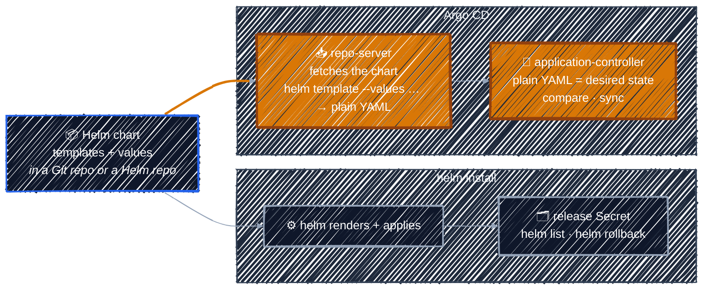

# Helm Charts in Argo CD

> Argo CD doesn't `helm install` your chart. It renders it to plain YAML and deploys that, like any other manifests.

---

So far the config repo held plain YAML. Most real software ships as a **Helm chart** instead: templates plus a `values.yaml`, rendered into Kubernetes YAML. Argo CD supports charts natively. You point an Application at a chart, and the [repo-server](../argocd-core-concepts/architecture.md) renders it before the application-controller compares and syncs, exactly as it did for guestbook.

### Argo CD runs `helm template`, not `helm install`

This is the most common Helm misconception with Argo CD. The two paths look like this:



Because Argo CD only *renders* the chart, there is no Helm release, and so no Helm history:

| With `helm install` | With Argo CD |
|---------------------|--------------|
| `helm list` shows the release | `helm list` shows **nothing**. Look in Argo CD instead. |
| `helm history` lists its revisions | `helm history` finds no release. The history is **Git's log**, plus `argocd app history` for what was synced when. |
| `helm upgrade` changes it | **Commit** a change to Git, then sync |
| `helm rollback` undoes it | **Revert** the commit in Git, then sync |
| `helm uninstall` removes it | `argocd app delete` removes the Application and what it deployed |
| Release name chosen on the command line | Release name = the **Application name** (override with `spec.source.helm.releaseName`) |
| Helm hooks run | Most Helm hooks are translated into Argo CD sync hooks |

> Never run `helm install` or `helm upgrade` on something Argo CD manages. It's the same as `kubectl apply` by hand: [drift](../gitops-intro/push-model.md#configuration-drift) that Argo CD will report and, with self-heal, undo.

### Where a chart can come from

| Chart lives in | Application `source` | Covered in |
|----------------|----------------------|------------|
| **A Git repo** (your own chart) | `repoURL` = the Git repo, `path` = the folder with `Chart.yaml` | the lab below |
| **A Helm repository** (a public chart) | `repoURL` = the Helm repo, `chart` = its name, `targetRevision` = the chart version | [Deploying Public Helm Charts](public-helm-charts.md) |

For a Git source you don't tell Argo CD it's Helm. The repo-server sees `Chart.yaml` in the folder and switches to Helm on its own. The Application looks exactly like the guestbook one, except for `path`:

```yaml
  source:
    repoURL: https://github.com/<YOUR_GITHUB_USER>/argocd-apps.git
    targetRevision: HEAD
    path: helm-guestbook # contains Chart.yaml, so Argo CD renders it with Helm
```

### What if you just change `path` on the existing app?

Editing the `guestbook` Application from [Part 4](../argocd-core-concepts/applications-vs-manifests.md#lab-deploy-your-first-application) and changing only `path: guestbook` to `path: helm-guestbook` works, but not the way most people expect:

| Step | What happens |
|------|--------------|
| Render | The repo-server finds `Chart.yaml` and switches to Helm. Nothing else in the Application changes. |
| Release name | It's the **Application name**, `guestbook`, not `helm-guestbook`. The chart names its resources `<release>-<chart>` unless the release name already contains the chart name, so you get `guestbook-helm-guestbook`. |
| Old resources | `guestbook-ui` Deployment and Service are no longer in the desired state, but still carry the app's [tracking annotation](../argocd-core-concepts/applications-vs-manifests.md#consequences-worth-knowing). Argo CD marks them **OutOfSync, requires pruning**. |
| Sync | A plain sync creates `guestbook-helm-guestbook` and leaves `guestbook-ui` running. Two guestbooks share the namespace, and the app stays OutOfSync until you sync with `--prune`. |

```bash
cd ~/argocd-apps   # wherever you cloned your fork
helm template guestbook ./helm-guestbook | grep -E '^kind|^  name'
# kind: Service
#   name: guestbook-helm-guestbook
# kind: Deployment
#   name: guestbook-helm-guestbook
```

Three things to take away:

- **An Application is identified by its name, not its source.** Changing `path` doesn't make a new app; it replaces what the same app wants deployed.
- **The Application name decides the Helm release name, and so the resource names.** Pin them with `spec.source.helm.releaseName` or the chart's `fullnameOverride` value if they matter.
- **Resources that drop out of the desired state aren't deleted until you prune.** Same rule as [`automated.prune`](../argocd-core-concepts/sync-and-health.md#sync-policy-who-presses-sync): Argo CD never deletes anything unless you ask.

That's why the lab below creates a **new** Application, `helm-guestbook`, instead of repointing `guestbook`.

### Lab: Deploy a Helm Chart from Git

> Render the `helm-guestbook` chart yourself, then let Argo CD deploy it, and see that Helm itself knows nothing about it.

<details>
<summary><b>Show the lab steps</b></summary>

**Goal:** deploy the `helm-guestbook` chart from your fork and confirm that Argo CD deployed rendered YAML, not a Helm release.

**Before you start:** you're logged in to Argo CD and have your fork of `argocd-apps` cloned on the VM, from [Lab: Deploy Your First Application](../argocd-core-concepts/applications-vs-manifests.md#lab-deploy-your-first-application). Run the commands on the VM.

#### 1. Update your fork

The chart was added to `argocd-apps` after you may have forked it. On GitHub, open your fork and click **Sync fork** → **Update branch**, then pull:

```bash
cd ~/argocd-apps   # wherever you cloned your fork
git pull
ls -A helm-guestbook/ helm-guestbook/templates/
# helm-guestbook/:
# .helmignore  Chart.yaml  templates  values-production.yaml  values.yaml
#
# helm-guestbook/templates/:
# NOTES.txt  _helpers.tpl  deployment.yaml  service.yaml
```

| File | What it is |
|------|------------|
| `Chart.yaml` | the chart's name (`helm-guestbook`) and version (`0.1.0`). Its presence is what tells Argo CD "this is Helm". |
| `.helmignore` | files to leave out when the chart is packaged, like `.gitignore` |
| `templates/deployment.yaml`, `templates/service.yaml` | a Deployment and a Service, with `{{ .Values... }}` placeholders |
| `templates/_helpers.tpl` | named templates (`helm-guestbook.fullname`, `.name`, `.chart`) the two manifests use for names and labels. Files starting with `_` render to nothing on their own. |
| `templates/NOTES.txt` | the "how to reach your app" text `helm install` prints afterwards |
| `values.yaml` | the defaults: 1 replica, the `gb-frontend:v5` image, a `ClusterIP` Service on port 80, Ingress off |
| `values-production.yaml` | overrides for production: the Service becomes a `LoadBalancer`. The labs don't use it, since a kubeadm cluster has no load balancer to give it an IP. |

#### 2. Render it yourself

Run what the repo-server will run, using the Application name as the release name:

```bash
helm template helm-guestbook ./helm-guestbook
```

The output is a plain Service (`type: ClusterIP`) and Deployment (`replicas: 1`), both named `helm-guestbook`. This YAML is what Argo CD compares and applies. Nothing about it is Helm-specific any more. A few details are worth noticing:

| In the output | Why |
|---------------|-----|
| Resources are named `helm-guestbook`, not `helm-guestbook-helm-guestbook` | `helm-guestbook.fullname` in `_helpers.tpl` uses just the release name when it already contains the chart name. Name the Application `guestbook-prod` and you'd get `guestbook-prod-helm-guestbook`: the Application name feeds straight into resource names. |
| Labels `release: helm-guestbook` and `heritage: Helm` | Just template text: `.Release.Name` and `.Release.Service`. `heritage: Helm` doesn't mean a Helm release exists, as step 4 shows. |
| No `NOTES.txt` text | `helm template` doesn't print NOTES, so Argo CD never shows them either. |

#### 3. Create the Application

In the tutorial clone, edit [`manifests/argocd-helm/helm-guestbook.yaml`](../../manifests/argocd-helm/helm-guestbook.yaml) and replace `<YOUR_GITHUB_USER>` with your GitHub account. Then apply it and sync:

```bash
cd ~/argoCD-tutorial   # wherever you cloned the tutorial
kubectl apply -f manifests/argocd-helm/helm-guestbook.yaml
argocd app sync helm-guestbook
argocd app wait helm-guestbook --health
```

```bash
argocd app get helm-guestbook               # Synced, Healthy
kubectl get deploy,svc -n helm-guestbook    # helm-guestbook Deployment and Service
```

In the UI, the app's **App Details** shows the source type as **Helm**, and the **Parameters** tab lists the values the chart was rendered with.

The Service is `ClusterIP`, so reach it the way the chart's `NOTES.txt` suggests, with a port-forward:

```bash
kubectl -n helm-guestbook port-forward svc/helm-guestbook 8083:80
```

Open `http://localhost:8083` (tunnel it with `ssh -L 8083:localhost:8083 …` if the VM is remote, as in [Accessing Argo CD](../argocd-getting-started/accessing-argocd.md)). It's the same guestbook page as before, deployed from a chart this time. Press `Ctrl+C` to stop.

#### 4. Look for the Helm release

```bash
helm list -A
# NAME     NAMESPACE  REVISION  STATUS    CHART
# argocd   argocd     1         deployed  argo-cd-<version>
```

There **is** a release, `argocd`: Argo CD itself was [installed with `helm install`](../argocd-getting-started/installing-argocd.md). There's no `helm-guestbook` release next to it, because nothing ever ran `helm install` for it. (Your cluster may list a few other releases too; what matters is the one that's missing.)

```bash
helm history helm-guestbook -n helm-guestbook  # Error: release: not found
argocd app history helm-guestbook              # one entry per sync: ID, date, Git revision
argocd app manifests helm-guestbook            # the rendered YAML Argo CD applied
```

Argo CD keeps the deployment history Helm would have kept, recording which Git revision each sync applied. To change this app you change Git, not Helm.

#### Checkpoint

| You did | Which means |
|---------|-------------|
| Pointed `path` at a folder with `Chart.yaml` | Argo CD rendered it with Helm, no extra settings needed |
| `helm template` locally | you saw exactly what Argo CD deploys |
| `helm list` showed `argocd` but no `helm-guestbook` | Argo CD deploys rendered YAML; there's no Helm release to upgrade or roll back |
| `argocd app history` listed the sync | the history lives in Argo CD and Git, not in Helm |

Leave `helm-guestbook` running: [Overriding Chart Values](chart-values.md) changes its values.

</details>

---

[← Sync and Health Checks](../argocd-core-concepts/sync-and-health.md) · [↑ Contents](../../README.md) · [Deploying Public Helm Charts →](public-helm-charts.md)
