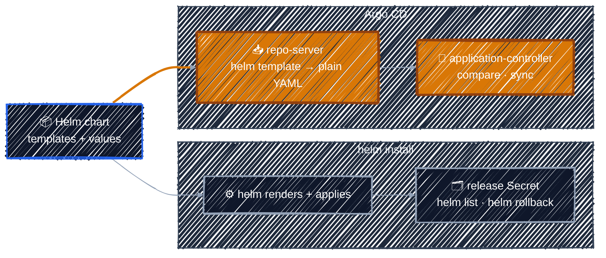

# Helm Charts in Argo CD

> Argo CD doesn't `helm install` your chart. It renders it to plain YAML and deploys that, like any other manifests.

---

So far the config repo held plain YAML. Most real software ships as a **Helm chart** instead: templates plus a `values.yaml`, rendered into Kubernetes YAML. Argo CD supports charts natively. You point an Application at a chart, and the [repo-server](../argocd-core-concepts/architecture.md) renders it before the application-controller compares and syncs, exactly as it did for guestbook.

### Argo CD runs `helm template`, not `helm install`

This is the most common Helm misconception with Argo CD. The two paths look like this:



Because Argo CD only *renders* the chart, there is no Helm release:

| With `helm install` | With Argo CD |
|---------------------|--------------|
| `helm list` shows the release | `helm list` shows **nothing**. Look in Argo CD instead. |
| `helm upgrade` changes it | **Commit** a change to Git, then sync |
| `helm rollback` undoes it | **Revert** the commit in Git, then sync |
| Release name chosen on the command line | Release name = the **Application name** (override with `spec.source.helm.releaseName`) |
| Helm hooks run | Most Helm hooks are translated into Argo CD sync hooks |

> Never run `helm install` or `helm upgrade` on something Argo CD manages. It's the same as `kubectl apply` by hand: [drift](../gitops-intro/push-model.md#configuration-drift) that Argo CD will report and, with self-heal, undo.

### Where a chart can come from

| Chart lives in | Application `source` | Covered in |
|----------------|----------------------|------------|
| **A Git repo** (your own chart) | `repoURL` = the Git repo, `path` = the folder with `Chart.yaml` | the lab below |
| **A Helm repository** (a public chart) | `repoURL` = the Helm repo, `chart` = its name, `targetRevision` = the chart version | [Deploying Public Helm Charts](public-helm-charts.md) |

For a Git source you don't tell Argo CD it's Helm. The repo-server sees `Chart.yaml` in the folder and switches to Helm on its own. The Application looks exactly like the guestbook one, except for `path`:

```yaml
  source:
    repoURL: https://github.com/<YOUR_GITHUB_USER>/argocd-apps.git
    targetRevision: HEAD
    path: helm-guestbook # contains Chart.yaml, so Argo CD renders it with Helm
```

### Lab: Deploy a Helm Chart from Git

> Render the `helm-guestbook` chart yourself, then let Argo CD deploy it, and see that Helm itself knows nothing about it.

<details>
<summary><b>Show the lab steps</b></summary>

**Goal:** deploy the `helm-guestbook` chart from your fork and confirm that Argo CD deployed rendered YAML, not a Helm release.

**Before you start:** you're logged in to Argo CD and have your fork of `argocd-apps` cloned on the VM, from [Lab: Deploy Your First Application](../argocd-core-concepts/applications-vs-manifests.md#lab-deploy-your-first-application). Run the commands on the VM.

#### 1. Update your fork

The chart was added to `argocd-apps` after you may have forked it. On GitHub, open your fork and click **Sync fork** → **Update branch**, then pull:

```bash
cd ~/argocd-apps   # wherever you cloned your fork
git pull
ls helm-guestbook/
# Chart.yaml  templates  values-production.yaml  values.yaml
```

| File | What it is |
|------|------------|
| `Chart.yaml` | the chart's name and version. Its presence is what tells Argo CD "this is Helm". |
| `templates/` | a Deployment and a Service, with `{{ .Values... }}` placeholders |
| `values.yaml` | the defaults: 1 replica, the guestbook image, a ClusterIP Service |
| `values-production.yaml` | overrides for production, used in [Overriding Chart Values](chart-values.md) |

#### 2. Render it yourself

Run what the repo-server will run, using the Application name as the release name:

```bash
helm template helm-guestbook ./helm-guestbook
```

The output is a plain Service and Deployment named `helm-guestbook` with `replicas: 1`. This YAML is what Argo CD compares and applies. Nothing about it is Helm-specific any more.

#### 3. Create the Application

In the tutorial clone, edit [`manifests/argocd-helm/helm-guestbook.yaml`](../../manifests/argocd-helm/helm-guestbook.yaml) and replace `<YOUR_GITHUB_USER>` with your GitHub account. Then apply it and sync:

```bash
cd ~/argoCD-tutorial   # wherever you cloned the tutorial
kubectl apply -f manifests/argocd-helm/helm-guestbook.yaml
argocd app sync helm-guestbook
argocd app wait helm-guestbook --health
```

```bash
argocd app get helm-guestbook               # Synced, Healthy
kubectl get deploy,svc -n helm-guestbook    # helm-guestbook Deployment and Service
```

In the UI, the app's **App Details** shows the source type as **Helm**, and the **Parameters** tab lists the values the chart was rendered with.

#### 4. Look for the Helm release

```bash
helm list -A | grep helm-guestbook   # nothing
argocd app manifests helm-guestbook  # the rendered YAML Argo CD applied
```

`helm list` is empty because no `helm install` ever ran. To change this app you change Git, not Helm.

#### Checkpoint

| You did | Which means |
|---------|-------------|
| Pointed `path` at a folder with `Chart.yaml` | Argo CD rendered it with Helm, no extra settings needed |
| `helm template` locally | you saw exactly what Argo CD deploys |
| `helm list` came back empty | Argo CD deploys rendered YAML; there's no Helm release to upgrade or roll back |

Leave `helm-guestbook` running: [Overriding Chart Values](chart-values.md) changes its values.

</details>

---

[← Sync and Health Checks](../argocd-core-concepts/sync-and-health.md) · [↑ Contents](../../README.md) · [Deploying Public Helm Charts →](public-helm-charts.md)
