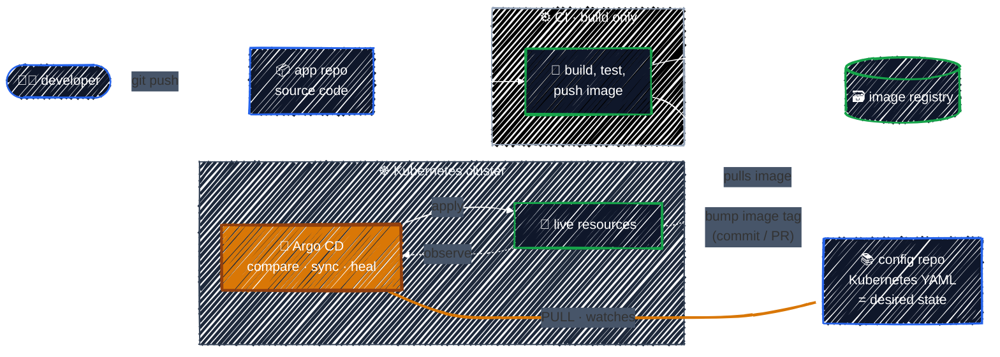

# The GitOps Workflow

> Flip the direction: instead of CI pushing into the cluster, an agent *inside* the cluster pulls from Git and keeps the cluster matching it.

---

GitOps keeps Git as the place where the desired state lives, but changes **who applies it**. The pipeline no longer touches the cluster. Instead, a controller running *in* the cluster, here Argo CD, watches a Git repo and continuously reconciles the cluster toward it. It's the same control-loop idea Kubernetes uses for Deployments, applied one level up.

### One change, end to end

1. **Change the code.** A developer opens a PR in the **app repo**. It is reviewed and merged.
2. **CI builds, and stops there.** The pipeline tests the code, builds an image such as `myapp:1.4.2`, and pushes it to the registry. It has **no cluster credentials**.
3. **Update the desired state in Git.** CI (or a person) commits the new image tag to the **config repo**, usually through a PR so the change is reviewed like code.
4. **Argo CD notices.** It polls the repo (every 3 minutes by default) or receives a webhook, and compares the new desired state with the live cluster. The app shows as **`OutOfSync`**.
5. **Argo CD syncs.** It applies the difference from *inside* the cluster, then tracks the resources until they're **`Healthy`**. The status shows in the UI and CLI, not just in a pipeline log.
6. **Argo CD keeps watching.** If someone runs `kubectl scale` or `kubectl edit` later, Argo CD sees the drift. It can report it, or with self-heal turned on, revert it automatically.

### What changes compared to push

| | Push (CI deploys) | Pull (GitOps) |
|---|---|---|
| Who applies changes | CI pipeline, from outside | Argo CD, from inside the cluster |
| Cluster credentials | stored in CI | stay in the cluster |
| Network direction | CI → cluster API (inbound) | cluster → Git (outbound) |
| When it runs | once per pipeline run | continuously |
| Drift | invisible | detected, optionally reverted |
| Deploy record | pipeline logs | Git history |
| Rollback | re-run an old pipeline | `git revert` |

### Two repos: app and config

The diagram uses two repos on purpose:

- **App repo**: source code, Dockerfile, tests. It changes often and triggers CI.
- **Config repo**: Kubernetes manifests (plain YAML, Kustomize, or Helm values). It changes only when what's deployed should change, and Argo CD watches it.

Keeping them separate means a README typo doesn't trigger a deploy, cluster config can have different reviewers than code, and CI updating an image tag can't loop back and trigger itself. One repo also works for small projects. Argo CD can watch a sub-path. But the two-repo split is the common default.

> The key idea: **every change to the cluster is a Git commit.** Deploying, rolling back and auditing all become Git operations you already know: PR, merge, revert, log.

---

[← The Push Model and Its Drawbacks](push-model.md) · [↑ Contents](../../README.md) · [The GitOps Principles →](gitops-principles.md)
