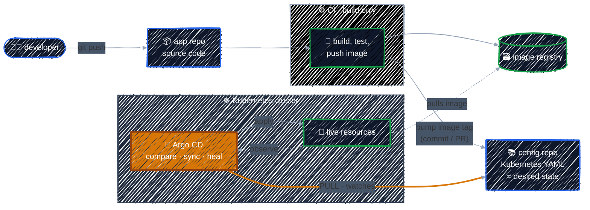

# The GitOps Workflow

> Flip the direction: instead of CI pushing into the cluster, an agent *inside* the cluster pulls from Git and keeps the cluster matching it.

---

GitOps keeps Git as the place where the desired state lives, but changes **who applies it**. The pipeline no longer touches the cluster. Instead, a controller running *in* the cluster, here Argo CD, watches a Git repo and continuously reconciles the cluster toward it. It's the same control-loop idea Kubernetes uses for Deployments, applied one level up.

> **Why two repos?** The **app repo** holds code and triggers CI. The **config repo** holds the Kubernetes YAML that Argo CD watches. Keeping them apart means a code change alone never deploys anything. Only a change to the config repo does.

### One change, end to end

1. **Open a PR.** A developer pushes a branch and opens a PR in the **app repo**. CI runs lint and unit tests, and the PR is merged once they pass.
2. **CI builds, and stops there.** On merge to `main`, CI builds the image and pushes it, such as `myapp:1.4.2`, to the registry. It never touches the cluster.
3. **Update Git.** CI commits the new image tag to the **config repo**, or opens a PR for someone to review. CI now needs write access to Git, not to the cluster.
4. **Argo CD notices.** It checks the repo every 3 minutes by default and sees that Git and the cluster differ: the app is **`OutOfSync`**.
5. **Argo CD syncs.** With automated sync it applies the change on its own; otherwise it waits for you to press Sync. Either way it applies from *inside* the cluster and waits until it's **`Healthy`**.
6. **Argo CD keeps watching.** If someone changes the cluster with `kubectl` later, Argo CD marks the app `OutOfSync` and, with self-heal turned on, changes it back.

> **Other ways to update the config repo.** You can also edit the YAML by hand, run a workflow inside the config repo, or let a tool like Argo CD Image Updater do it. Whatever the method, the change has to land in Git.

### Push vs. pull

| | Push (CI deploys) | Pull (GitOps) |
|---|---|---|
| Who applies changes | CI, from outside the cluster | Argo CD, from inside |
| Cluster credentials | stored in CI | never leave the cluster |
| After the deploy | the job exits | keeps comparing and reports health |
| Drift | goes unnoticed | detected, and can be reverted |
| Audit trail | pipeline logs, plus whatever `kubectl` did | `git log`: every change has an author and a reason |
| Rollback | re-run an old pipeline | `git revert` |

> The key idea: **every change to the cluster is a Git commit.** Deploying, rolling back and auditing all become Git operations you already know: PR, merge, revert, log.

---

[← The Push Model and Its Drawbacks](push-model.md) · [↑ Contents](../../README.md) · [The GitOps Principles →](gitops-principles.md)
