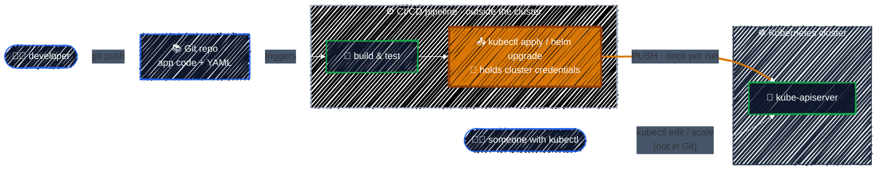

# The Push Model and Its Drawbacks

> The usual way to deploy is for CI to push changes into the cluster. It works until the cluster quietly stops matching what you think you deployed.

---

Before GitOps, the usual way to deploy to Kubernetes is a **push model**: a CI/CD pipeline (Jenkins, GitHub Actions, GitLab CI, …) builds the image, then reaches *into* the cluster and runs `kubectl apply` or `helm upgrade`.



This is the same **imperative** habit as running `kubectl apply` by hand. It's just automated: something outside the cluster issues a command, and the job is considered done once the command succeeds.

### The drawbacks

| Problem | Why it happens in a push model |
|---------|-------------------------------|
| 🔑 **Credentials live outside the cluster** | The pipeline needs a kubeconfig with write access, often cluster-admin. Every CI runner, secret store and plugin that can read it can change production. |
| 🌐 **The cluster must be reachable from CI** | The API server has to be open to the pipeline's network. That's harder with private clusters, and gets worse with every extra cluster you add. |
| 🎯 **"Deployed" means "the command succeeded"** | `kubectl apply` returning 0 doesn't mean the Pods became healthy. Once the job ends, nobody is watching. |
| 🧭 **Git is not the source of truth** | Anyone with `kubectl` can change the cluster directly. Git shows what was pushed *once*, not what's running *now*. |
| 🔁 **Nothing corrects changes** | The pipeline only runs on a new commit. If the cluster is changed in between, the change just stays. |
| ⏪ **Rollback means re-running the pipeline** | You redeploy an old build or run `kubectl rollout undo`. Both are separate actions, and neither leaves a record in Git. |

The last three rows add up to the most common problem of all: **configuration drift**.

### Configuration drift

**Configuration drift** is when the live state of the cluster slowly moves away from the desired state written in Git. It happens through small, usually well-meant changes:

- a `kubectl scale` during a traffic spike that nobody scales back,
- a `kubectl edit` hotfix at 2 a.m. that never makes it into the repo,
- a `kubectl set image` to test something, then forgotten.

Each change is harmless on its own. But afterwards **nobody knows what is actually running**, and the next pipeline run either silently overwrites the hotfix or leaves fields it doesn't manage untouched. Either way, the YAML in Git is no longer a reliable description of the cluster.

> A push model can't detect drift. The pipeline compares nothing: it pushes and exits.

### Try it — create drift by hand

[`manifests/gitops-intro/drift-demo.yaml`](../../manifests/gitops-intro/drift-demo.yaml) is the desired state stored in Git: 2 replicas of `nginx:1.27`. Apply it once, the same way a push pipeline would:

```bash
kubectl apply -f manifests/gitops-intro/drift-demo.yaml
kubectl get deploy drift-demo        # READY 2/2
```

Now change the cluster directly with `kubectl`, bypassing Git:

```bash
kubectl scale deploy drift-demo --replicas=5
kubectl set image deploy/drift-demo nginx=nginx:1.28
```

Ask Kubernetes how the cluster now differs from the file:

```bash
kubectl diff -f manifests/gitops-intro/drift-demo.yaml
```

The diff shows `replicas: 5 → 2` and `nginx:1.28 → nginx:1.27`: the cluster has **drifted**. (`kubectl diff` exits with code `1` when it finds differences. That's expected, not an error.)

Notice what *doesn't* happen: nothing puts it back. The cluster keeps running 5 Pods of 1.28 until someone notices and runs the pipeline again. In [Getting Started with Argo CD](../argocd-getting-started/overview.md) you'll do the same experiment with Argo CD watching, and see it mark the app `OutOfSync` and undo the change.

Clean up:

```bash
kubectl delete -f manifests/gitops-intro/drift-demo.yaml
```

---

[← Install Argo CD](../environment-setup/install-argocd.md) · [↑ Contents](../../README.md) · [The GitOps Workflow →](gitops-workflow.md)
