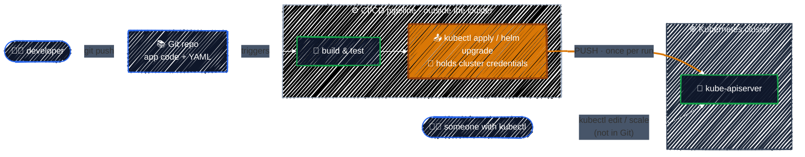

# The Push Model and Its Drawbacks

> The usual way to deploy is for CI to push changes into the cluster. It works until the cluster quietly stops matching what you think you deployed.

---

Before GitOps, the usual way to deploy to Kubernetes is a **push model**: a CI/CD pipeline (Jenkins, GitHub Actions, GitLab CI, …) builds the image, then reaches *into* the cluster and runs `kubectl apply` or `helm upgrade`.



This is the same **imperative** habit as running `kubectl apply` by hand. It's just automated: something outside the cluster issues a command, and the job is considered done once the command succeeds.

### The drawbacks

| Problem | Why |
|---------|-----|
| 🔑 **CI holds the keys to the cluster** | The pipeline needs a kubeconfig with write access. Anyone who can read it, such as another CI job or a leaked log, can change production. |
| 👀 **Nobody watches after the deploy** | The job ends when `kubectl apply` succeeds. Whether the Pods actually became healthy, or changed later, nothing checks. |
| 🕵️ **No record of who changed what** | A `kubectl` change leaves no commit, no review and no reason. Git shows what the pipeline deployed, not what's actually running. |
| ⏪ **Rollback means re-deploying** | Undoing a bad release means finding the last good build and re-running its pipeline, under pressure, sometimes for several services at once. |
| 🔀 **The cluster drifts away from Git** | Anyone with `kubectl` can change the cluster directly, and nothing changes it back. |

The last one has a name: **configuration drift**.

### Configuration drift

**Configuration drift** is when the live cluster slowly stops matching the YAML in Git. It comes from small, well-meant changes: a `kubectl scale` during a traffic spike or a `kubectl edit` hotfix at 2 a.m. that never makes it back into the repo.

Each one is harmless alone. Together they mean **Git no longer tells you what's actually running**, and a push model can't notice: the pipeline pushes and exits.

With several environments it gets worse: dev, staging and prod each drift in their own way, so a release that worked in staging may not behave the same in prod.

### Try it — create drift by hand

[`manifests/gitops-intro/drift-demo.yaml`](../../manifests/gitops-intro/drift-demo.yaml) is the desired state stored in Git: 2 replicas of `nginx:1.27`. Apply it once, the same way a push pipeline would:

```bash
kubectl apply -f manifests/gitops-intro/drift-demo.yaml
kubectl get deploy drift-demo        # READY 2/2
```

Now change the cluster directly with `kubectl`, bypassing Git:

```bash
kubectl scale deploy drift-demo --replicas=5
kubectl set image deploy/drift-demo nginx=nginx:1.28
```

Ask Kubernetes how the cluster now differs from the file:

```bash
kubectl diff -f manifests/gitops-intro/drift-demo.yaml
```

The diff shows `replicas: 5 → 2` and `nginx:1.28 → nginx:1.27`: the cluster has **drifted**. (`kubectl diff` exits with code `1` when it finds differences. That's expected, not an error.)

Notice what *doesn't* happen: nothing puts it back. The cluster keeps running 5 Pods of 1.28 until someone notices and runs the pipeline again. In the [sync lab](../argocd-core-concepts/sync-and-health.md#lab-the-sync-process) you'll do the same experiment with Argo CD watching, and see it mark the app `OutOfSync` and undo the change.

Clean up:

```bash
kubectl delete -f manifests/gitops-intro/drift-demo.yaml
```

---

[← Set Up a Cluster](../environment-setup/setup-cluster.md) · [↑ Contents](../../README.md) · [The GitOps Workflow →](gitops-workflow.md)
